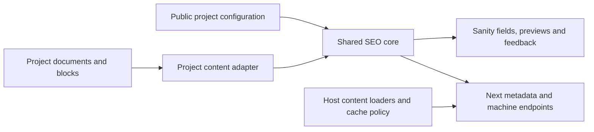

# Standalone Sanity + Next.js SEO plugin plan

The [v0.2 plan](docs/v0.2-plan.md) is the current next-version roadmap. It supersedes the initial deferral of a separate SEO tool and adds Yoast-style settings, Health, Optimize, Workflow, and a release/update pipeline. The architecture and initial-release criteria below remain background for 0.1.0.

Updated 2026-10-20. Build a reusable, installable package for future projects. The existing Sanity project becomes the first consumer, not the home of the implementation.

This replaces the earlier application-specific approach. Supporting Yoast findings: [YOAST-ANALYSIS.md](YOAST-ANALYSIS.md). Implementation is now in this workspace; current usage and verification commands are in [README.md](README.md). The original client applications remain unchanged, and no registry publication has occurred.

## Package architecture

Ship **one npm package with three public entry points**. Working name: `@gerald/seo`; ownership and registry availability have not been checked.

| Entry point | Responsibility | Dependency boundary |
|---|---|---|
| `@gerald/seo/core` | Configuration/types, normalized content, metadata defaults, URL/indexing policy and deterministic checks | No React, Sanity, Next, DOM or network imports. |
| `@gerald/seo/sanity` | Sanity plugin, reusable SEO field, search/social previews and analysis UI | Sanity/React/UI; no Next server code. |
| `@gerald/seo/next` | Next Metadata adapter, safe JSON-LD rendering, sitemap/robots builders | Next App Router; no Studio/UI dependency in its runtime import graph. |

One package/version keeps Studio and frontend behavior aligned. Separate exports keep framework code out of the wrong runtime. Do not create three packages, a hosted service or an installer CLI for the first release.

Sanity supports npm-distributed plugins through `definePlugin`: [developing plugins](https://www.sanity.io/docs/studio/developing-plugins), [plugin API](https://www.sanity.io/docs/studio/plugins-api-reference). Preserve Next's server/client import boundaries: [Server and Client Components](https://nextjs.org/docs/app/getting-started/server-and-client-components).



## Installation contract

A new supported project should:

1. Install the package in Studio and Next. During development, install its packed tarball.
2. Supply public site configuration and document/content adapters.
3. Register `seoPlugin(config)` in Studio and explicitly add `seoField()` to selected document schemas.
4. Include the exported SEO projection in host GROQ queries, or map existing SEO fields into the normalized contract; regenerate host types where used.
5. Call package helpers from existing `generateMetadata`, page JSON-LD rendering, `sitemap.ts` and `robots.ts`.
6. Configure host publication/cache invalidation and verify preview versus published output.

The plugin and field API names are implemented. Public entry points, integration details and complete consumer examples are documented in [README.md](README.md); this document retains the implementation/release acceptance criteria.

Explicit schema opt-in avoids injecting fields into unrelated documents or colliding with an existing SEO object. The package owns the engine and UI; projects retain short framework route wrappers, loaders and mappings.

Installation alone cannot discover arbitrary routes or understand every custom block. The target is installation plus a small configuration/adapter, with no copied SEO implementation.

## Project configuration

| Extension point | Host supplies |
|---|---|
| Site | Validated production origin, name, description and default social image; no credentials. |
| Document types | Selected types, whether page/article-like, and type indexing defaults. No fixed assumption about page/post names. |
| Field mapping | Title, SEO object, excerpt, image, dates and optional real author. Support conventional defaults and explicit overrides. |
| Route resolver | Document to production pathname, including homepage, nested paths and locale prefixes when present. Host owns actual route availability and collisions. |
| Content extraction | Package Portable Text adapter plus project callbacks for custom sections and frontend-generated headings/links/images. |
| Settings | Host maps existing settings or supplies code defaults. Optional package settings schema for new projects; do not force competing settings singletons. |
| Data/cache integration | Host loads published or preview documents/settings and controls invalidation. Package helpers consume normalized values, without embedded private clients or universal queries. |

Keep shared public configuration independent of server clients, cookies and tokens. Authenticated loaders belong in separate server modules so Studio imports cannot expose secrets.

Callbacks are executable configuration imported by each app, not functions serialized into Sanity. Studio can load references/settings asynchronously, but core resolution/checking stays pure and synchronous. Cache reference lookups and disclose incomplete analysis instead of falsely passing checks.

Reuse one configuration module where consumer repository layout permits. Where apps deploy from separate repositories, version the small project adapter consistently and verify shared fixtures.

## Shared data and behavior

Register a namespaced reusable SEO schema type and a field helper with a configurable field name. Start with optional title, description, social image/alt, canonical URL, inherit/index/noindex policy and focus keyphrase.

The keyphrase is an editorial input, not a public meta-keywords tag. Length advice warns; malformed URLs/configuration fail validation. Validate again at output boundaries because API writes can bypass Studio checks. Older documents must work through defaults without bulk mutation.

Core accepts normalized document identity, resolved route, title, meaningful description text, image, actual article facts when available, SEO overrides, locale and ordered content semantics. Represent analysis content as paragraphs, headings, links and images with optional source paths for feedback.

The Portable Text adapter preserves heading levels, paragraphs and link marks. Host adapters supply custom block semantics, resolved internal URLs and renderer-generated headings. Exclude navigation/footer boilerplate, raw IDs and hidden configuration text. Unsupported blocks or missing reference context must be visible as incomplete.

One resolver serves Studio and Next:

- Title: nonblank override, otherwise content title with one site suffix, otherwise site name.
- Description: nonblank override, otherwise mapped excerpt/meaningful paragraph, otherwise site description.
- Image: SEO override, otherwise mapped content image, otherwise site default.
- URL: validated production origin plus host pathname; validated canonical override takes precedence.
- Indexing: document policy, otherwise type default, otherwise index. Preview/staging output is independently noindex.
- Sitemap: public, routable, indexable local canonical content only; omit aliases/redirects and deduplicate.
- Initial noindex/canonical behavior follows observed Yoast behavior: omit canonical on noindex. Fixture and document this decision.

Define whitespace, URL schemes, trailing slashes, fragments and query handling explicitly and consistently with host routes. Never infer the production origin from request hosts or deployment preview URLs.

Keep scores transient initially. If a later dashboard requires persistence, include analyzer version and content revision/hash.

## Phase 1: package and core

Develop the package in this workspace. Keep the supplied WordPress tree as reference material.

```text
src/
  core/
  sanity/
  next/
tests/
examples/
  portable-text/
  custom-sections/
docs/
package.json
```

Deliver:

1. Typed configuration, normalized content contract, pure resolver and basic checks.
2. Explicit export map, generated declarations, source maps and documented module/Node targets. Start with modern ESM; add CommonJS only for a verified consumer need.
3. Peer ranges derived from tested React/Sanity/Next versions. Framework peers should be optional for users of only the other adapter, with clear errors when an adapter's own peers are absent.
4. Build settings preserving required `use client` directives and isolating Next server-only integration. No root barrel that imports both adapters.
5. A release files allowlist: built output, documentation/license and required assets. Exclude WordPress code, investigation evidence, examples, credentials and development files from the tarball.
6. Independently authored implementation and documented dependency/license provenance. Do not copy bundled Yoast code or branding.

Completion gate: build, pack, inspect the tarball and import each exported entry point in a clean consumer. Core must import without React, Sanity or Next.

## Phase 2: Next integration

Provide helpers consuming host-loaded normalized values:

1. Return Next Metadata for title, description, canonical, robots, Open Graph and X cards. Avoid duplicate manual tags or double title templates.
2. Render safely serialized connected JSON-LD: WebSite, publisher and WebPage; Article/BreadcrumbList only with applicable real content. Use stable production IDs and escape script-closing content.
3. Build sitemap entries from all eligible host documents plus explicit static routes. Do not assume a listing query covers the whole site, invent routes or add external canonicals to the local sitemap.
4. Build robots output from validated origin and deployment policy. Robots blocking is neither access control nor a substitute for noindex.
5. Supply working wrappers for published-only machine endpoints and stega-free metadata. Preview metadata may use the host draft/release perspective, while staying noindex and isolated from public caches.
6. Document actual invalidation for tested Next/next-sanity versions. Publication, unpublish/delete, route changes and settings changes must refresh metadata and sitemap.
7. Preserve host missing-document/error handling. Do not mask CMS failure as an empty successful sitemap.

Completion gate: a clean Next consumer emits correct metadata, JSON-LD, sitemap and robots using public package imports and documented project mappings.

API references: [Metadata](https://nextjs.org/docs/app/api-reference/functions/generate-metadata), [sitemap](https://nextjs.org/docs/app/api-reference/file-conventions/metadata/sitemap), [robots](https://nextjs.org/docs/app/api-reference/file-conventions/metadata/robots), [JSON-LD](https://nextjs.org/docs/app/guides/json-ld).

## Phase 3: Sanity plugin

1. Register schema/field components through the plugin API. Use host React and Sanity UI without duplicate framework runtimes.
2. Put fields, inherited-value indicators, search/social previews and basic checks in the reusable SEO field input. A separate dashboard/tool is unnecessary initially.
3. React to unsaved document values and configured source paths. Load reference/settings context through supported Studio APIs, then call the same resolver as Next.
4. Debounce checks, initially around the observed 500 ms; discard stale results. Analysis errors must not interrupt editing.
5. Preserve accessible inputs, keyboard use and advisory-versus-blocking validation. Link feedback to mapped source paths where possible.
6. Mark unsupported languages/content as unavailable. Label search/social previews approximate and document connection to the host's actual frontend preview.
7. Document uninstall consequences: removing UI does not delete stored SEO content, and retained fields may need retained schema definitions.

Completion gate: install the packed tarball into a clean Studio; verify unsaved edits, clearing overrides, settings/references and error handling.

## Phase 4: content and readability guidance

Start with independent checks for resolved metadata presence/approximate length, keyphrase placement, heading structure, long sections, links/link text, image alt and basic English sentence/paragraph readability.

Return stable check IDs, severity/status, explanatory messages, optional measurements and source paths. Keep core independent of UI colors. Any overall indicator is this product's heuristic, not an equivalent Yoast score.

Use fixtures for Portable Text and custom sections. The host adapter defines visible content, hidden carousel/rotating variants and generated H1s. Unknown custom blocks produce an incomplete-analysis warning.

Defer passive-voice dictionaries, transition words, synonyms, morphology and multilingual parity until evaluating a tested engine. Pixel-width title checks need a browser/DOM path; character guidance must be labeled approximate. Add a worker when profiling or engine requirements justify it.

Completion gate: useful feedback works locally without AI/network calls, stays responsive and accurately reports coverage limits. Editor analysis and real frontend-output checks remain separate.

## Phase 5: portability, compatibility and release

Test two deliberately different consumers:

| Consumer | Variation | Purpose |
|---|---|---|
| Existing Sanity project | Page/Post, homepage flag, detail URLs at `/{slug}`, reusable sections and legacy homepage | Real first integration through a project adapter. |
| Independent example | Different type/field/settings names, nested `/articles/{slug}` routes and a different custom block | Detect hidden assumptions about the original project. |

Both install the **packed tarball**, not source-relative imports or examples-only aliases. No edits to package source may be required for the second consumer.

Required verification:

1. Missing/blank overrides, inherited defaults, one title suffix and invalid configuration.
2. Home/nested routes, host-reported collisions, internal/external canonical overrides and noindex.
3. Published/draft/release separation, clean strings/production URLs and invalidation after publication/deletion/settings changes.
4. Missing image/author/date and malicious script-closing content; no fabricated schema facts.
5. Built-in/custom content adapters, missing references and unsupported checks.
6. Studio stale-result handling, editing behavior and accessible inputs.
7. Export/type resolution, preserved client directives, server/client isolation and no duplicate React.
8. Tarball contents and installation/build/render in both consumer fixtures.

Use the previously verified Next App Router 16 / Sanity Studio 6 project as the first compatibility target. Choose precise peer ranges only after testing installed versions and compatible React versions. Do not claim compatibility with every past/future major; Pages Router and other versions require separate validation.

Prepare README quickstart, complete examples, API/config reference, adapter recipe, supported versions, changelog, license and upgrade/uninstall guidance. Version both public APIs and stored schema shape; provide migration guidance when either changes. Upgrades must not silently mutate or republish documents.

Prepare a releasable artifact after these gates pass. Registry publication is a separate release action, outside this planning task.

## Existing project and later features

The current `sanity-frontend` and `sanity-studio` become consumers. Changes there should be dependency/configuration, schema opt-in, projections/types, project-specific content extraction and short route wrappers. The SEO engine/UI lives in the package from the beginning.

Its homepage `/`, Page/Post `/{slug}` and listing `/posts` routes are fixture-specific, never hard-coded package defaults.

After the first release: redirect schema/validation with explicit host deployment/runtime activation, dashboard, multiple keyphrases, deeper language rules and optional external integrations. Preserve former slug paths and reject redirect loops/duplicates. AI, rank tracking, automatic hreflang and llms.txt remain separate extensions.

## First release definition

An installable package with shared core, Sanity metadata fields/previews/basic checks, Next metadata/JSON-LD/sitemap/robots helpers, project adapters, two complete examples and package-level verification.

A new supported Sanity + Next project must integrate without changing package source or copying its engine/UI. Configuration, content adapters and framework route wrappers are the expected project work.

The standalone package and examples are implemented. Use `npm test` and `npm run test:package` for current verification; a successful package run writes `.artifacts/verification.json`. No live CMS mutation, existing application edit or registry publication is implied. Remaining deployment risks are host cache/preview configuration, incomplete custom-block mappings and overstating simplified SEO scoring.
