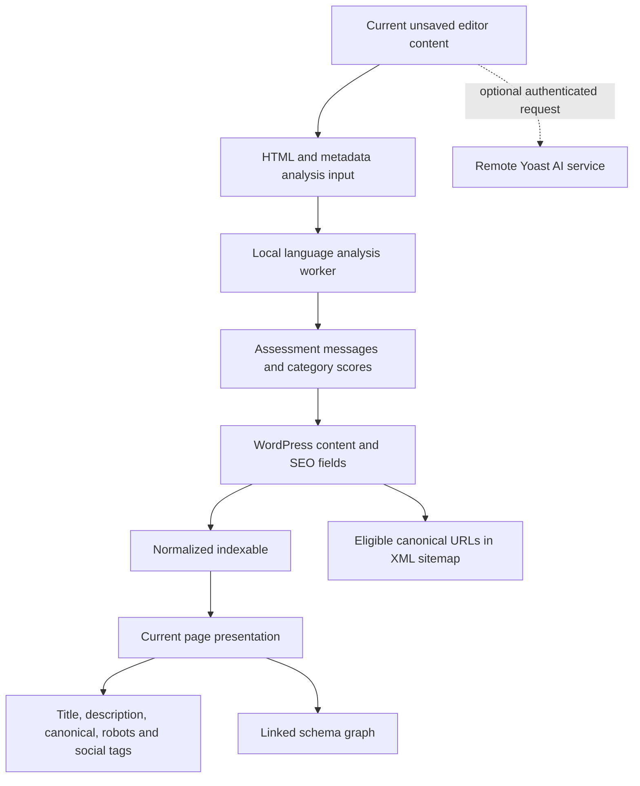

# Yoast SEO analysis for a Next.js + Sanity rebuild

Analyzed 2026-10-20. Updated scope: reproduce the editorial workflow and public SEO behavior as a standalone, installable Sanity + Next.js package. The existing apps are the first integration fixture. WordPress's storage, hooks, ORM, admin screens and subscription infrastructure are implementation details that do not need porting.

## Target and evidence boundary

- Local target: `plugins/`, identifying itself as **Yoast SEO 28.7** in `wp-seo.php:9-23` and `wp-seo-main.php:18`. This identifies the supplied copy; its distribution provenance was not independently authenticated.
- Entry-file SHA-256: `abf3c51882ab0ac122e9ec36d7182232ca5727364a6f3d9e98fc5795e6e4ca29`.
- Method: static PHP source inspection, focused inspection of compiled JavaScript and one scoped REA analysis. No WordPress installation, editor interaction or remote paid-service request was run.
- The full `js/dist` REA request returned `Invalid string length`. A second request successfully parsed a byte-for-byte temporary copy of **only** `js/dist/analysis-worker.js`. This is not a whole-plugin REA graph.
- Retained REA Evidence: `ev_7704cb2f22685b183badcb0bb1f027779d8e947ed7505aa4439f930e6ef993bd`, in [rea-worker.json](reports/evidence/rea-worker.json). The worker file digest is `b3170669fcb5ef2bea39958e5b3ec013d05e0d05a7af5314cad37d855fcd349f`; one 617-byte JavaScript file parsed with no parse failures. Inventory coverage is complete for that subset; semantic coverage is unknown/partial, especially dynamic properties and calls. No JavaScript was executed.
- IDs E01-E12 below are this report's source references, not REA-generated Evidence IDs. PHP findings come from readable source; larger editor findings come from bundled code outside the scoped REA graph.

## What the plugin actually does

The main product split is public output versus authoring guidance. A green editor score does not prove that the website emitted correct metadata. Each side needs its own checks.

| ID | Static observation and source | Translation |
|---|---|---|
| E01 | `inc/class-wpseo-meta.php:98-195` defines focus keyphrase, title, description, category scores, cornerstone, robots flags, canonical, breadcrumb title and schema types. `src/builders/indexable-post-builder.php:332-339` maps social overrides. | Reusable Sanity SEO object; separate editorial inputs from public output. |
| E02 | `src/builders/indexable-post-builder.php:114-191` maps post/meta data into an indexable. `src/integrations/front-end-integration.php:468-490` resolves context/presentation and passes it into presenters. | One deterministic metadata resolver, consumed by the framework adapters. No SEO database/indexable table is needed initially. |
| E03 | `src/presentations/indexable-post-type-presentation.php:147-173` applies title/description defaults. Social fallback chains occur in `src/presentations/indexable-presentation.php:425-461` and `src/presentations/indexable-post-type-presentation.php:181-200`. | Document overrides plus explicit site/type defaults. Use the same precedence in editor previews and public output. |
| E04 | `src/presentations/indexable-post-type-presentation.php:72-88` resolves override/permalink/pagination canonical. `src/presenters/canonical-presenter.php:38-49` omits canonical for noindex. Robots defaults and overrides occur in `src/presentations/indexable-presentation.php:294-320` and `src/presentations/indexable-post-type-presentation.php:309-340`. | Central URL and indexing policy. Decide noindex/canonical behavior explicitly; do not accidentally inherit layout directives. |
| E05 | `src/generators/schema-generator.php:48-112,219-322` selects necessary graph pieces and finalizes them. `src/generators/schema/webpage.php:30-111` connects page, website, author, breadcrumbs and image with IDs. | Connected JSON-LD graph derived from real content. Start with WebSite, publisher identity, WebPage and applicable Article/BreadcrumbList nodes. |
| E06 | `inc/sitemaps/class-post-type-sitemap-provider.php:207-214,599-618,632-675` excludes noindex, unpublished/protected, external and canonical-alias URLs. `:659-682` supplies dates/images; `inc/sitemaps/class-sitemaps.php:597-606` defaults to 1,000 entries per page. | Published, routable, indexable canonical URLs only. Do not copy the WordPress pagination machinery for a small site. |
| E07 | `admin/metabox/class-metabox.php:661-684` supplies worker dependencies. `js/dist/analysis-worker.js:1` imports allowlisted dependencies/translations and registers a language researcher and AnalysisWebWorker. Scoped REA Evidence above confirms the bootstrap artifact/parse, with dynamic-flow limits. | Sanity content adapter replaces WordPress editor glue. A worker is an optimization for heavy rules, not a requirement for metadata editing. |
| E08 | `js/dist/post-edit.js:1` creates a Paper from editor content, keyphrase, metadata, slug/URL, language and block information. Locate `const d={text:a.content`. Locate `app.refresh=(0,l.debounce)` for its 500 ms debounce. Results flow back to editor state and score fields; PHP save handling is in `admin/metabox/class-metabox.php:463-545`. | Analyze unsaved document values, debounce, discard stale results, keep scores transient until a dashboard requires persistence. |
| E09 | `js/dist/externals/analysis.js` contains local SEO/readability assessments. SEO and readability are separately configurable in `src/editors/framework/keyphrase-analysis.php:38-65` and `readability-analysis.php:38-65`. | Start with explainable checks. Full linguistic parity requires language-specific logic, not a short keyword counter. An exported assessment is not proof of Free activation. |
| E10 | `src/ai/http-request/infrastructure/api-client.php:24` names `https://ai.yoa.st/api/v1`. `src/ai/generator/application/suggestions-provider.php:87-105` sends content/context. `src/ai/generator/user-interface/route-permission-trait.php:22-29` checks editing permissions. Integration exposes subscription/consent in `ai-generator-integration.php:175-195`. | AI is a separate remote subsystem. The local analysis engine does not depend on an LLM. Yoast's private models/prompts and working entitlement behavior are unknown. |
| E11 | `src/llms-txt/application/configuration/llms-txt-configuration.php:58-67` and `src/llms-txt/infrastructure/content/automatic-post-collection.php:77-95,109-149,186-192` implement optional selection/configuration. | Optional later content export. Presence does not establish a ranking benefit. |
| E12 | `wp-seo.php:7,19,26-35`, `readme.txt:4` and `license.txt` declare GPL licensing. The bounded inspection did not establish standalone license/dependency provenance for every bundled JS module. | Default to independently authored UI and rules. Direct code/package reuse needs its own provenance and license review. This report is not a legal determination about a future distribution. |

## Analysis behavior worth understanding

Bundled assessments cover keyphrase placement/density/length, title width, meta description, slug, headings, links, image alt text, H1 count and text length. Readability includes paragraphs, sentences, subheading distribution, transition words and passive voice. Language, document type and cornerstone configuration affect applicable rules.

Examples recovered from `js/dist/externals/analysis.js` are implementation defaults, not universal search-engine requirements:

| Rule | Observed bundled default | Source locator |
|---|---|---|
| Description | 121-156 characters receives score 9; empty gets 1; shorter/longer bands get 6 | line 1, `recommendedMaximumLength:120` and surrounding assessment |
| SEO title | Approximately 400-600 px target; editor measures Arial at 20px | `analysis.js:366`; `post-edit.js:1`, `function bt` |
| Text length | Recommended minimum 300 words, with lower bands and overrides | `analysis.js:232` |
| Paragraph length | Recommendation 150 words; maximum band 200 | `analysis.js:189` |
| Sentence length | Over 20 words counts long; percentage bands at 25/30 | `analysis.js:161` |
| Passive voice | At most 10% scores 9; above 10-15% scores 6; above 15% scores 3 | `analysis.js:27` |
| Transition words | Below 20% scores 3; 20-<30% scores 6; at least 30% scores 9; short-text adjustment exists | `analysis.js:353` |
| Assessment color | At most 4 bad, above 4-7 okay, above 7 good; 0 feedback, -1 error | `analysis.js:85`, module `28092` |

These line references point into the supplied compiled artifact and will change in other builds. SEO and readability aggregate scores differ; a universal average would not replicate Yoast. The first implementation should expose individual advisory results and describe any overall indicator as its own heuristic. Character counts are useful guidance but do not duplicate pixel-width measurement or predict a search snippet.

## Fit to your existing Sanity project

The first candidate integration fixture was found at `C:/Users/Gerald/Projects/Sanity`. Its source was checked read-only during the initial analysis. Following the clarified standalone scope, these repositories demonstrate one consumer configuration; their schemas and routes must not be hard-coded into the reusable package.

| Current source | Verified state and consequence |
|---|---|
| `sanity-frontend/package.json`, `sanity-studio/package.json` | Next.js 16.4.2, next-sanity ^13.3.4, Sanity ^6.19.0 declared. Check installed docs and dependency lockfiles before implementation. |
| `sanity-studio/schemaTypes/pageType.ts:10-56` | Page title, slug, homepage flag and reusable section array; no SEO object. Add SEO at document level, preserving section authoring. |
| `sanity-studio/schemaTypes/postType.ts:8-34` | Post title, slug, publishedAt, image and Portable Text body; no SEO/excerpt/author fields. Article markup must use available real fields and omit unavailable author data. |
| `sanity-studio/schemaTypes/siteSettings.ts:40-53` | Existing settings document contains header/footer. Extend it with SEO defaults and publisher identity instead of creating competing site settings. |
| `sanity-frontend/src/app/layout.tsx:17` | Generic metadata title `Website`. No route-level generateMetadata found in the inspected app tree. |
| `sanity-frontend/src/app/page.tsx:9-36` | Homepage comes from a page with isHomepage; legacy runHomepage sections are still supported. Both content paths need metadata and extraction. |
| `sanity-frontend/src/app/[slug]/page.tsx:16,24-43` | Shared route resolves Page first, then Post. A homepage slug redirects to `/`. Canonical generation and sitemap selection must match this resolution order. |
| `sanity-frontend/src/app/posts/page.tsx:7-8,23-24` | `/posts` is a listing, currently limited to 12 results; detail links use `/{slug}`. Do not invent `/posts/{slug}` or limit the sitemap to those 12. |
| `sanity-frontend/src/sanity/live.ts:28-44` | Existing preview-aware fetch helper selects draft/release perspectives and enables stega in preview. Metadata needs clean strings; public sitemap/robots queries must never inherit request preview cookies. |
| `sanity-frontend/src/sanity/page-builder.ts`, `navigation.ts` | Existing typed projections and reference-based link handling should be extended. Homepage mapping already exists; do not create a conflicting slug resolver. |
| Inspected `sanity-frontend/src/app` inventory | No sitemap.ts or robots.ts found. No SEO-named schema/helper appeared in the bounded inventory. This is not an exhaustive negative search of every project file. |

## Feature priorities

| Feature | Recommended stage | Reason |
|---|---|---|
| Titles/descriptions, canonical, robots, social image/defaults | Technical foundation | Directly controls emitted SEO output. |
| Sitemap and robots.txt | Technical foundation | Framework-native endpoints with correct publication/canonical rules. |
| Publisher/WebSite/WebPage/Article graph | Technical foundation | Uses existing structured content; omit unsupported claims. |
| Search/social previews and SEO tab | Editor workflow | Makes defaults and overrides understandable to editors. |
| Keyphrase, heading/link/alt checks and basic readability | Editor guidance | Core Yoast-like feedback without WordPress dependencies. |
| Rich linguistic analysis, synonyms, multiple keyphrases | Later parity work | Language support and calibration are substantial work. |
| Redirect manager and slug-change workflow | After core editor workflow | Useful, but requires explicit deployment/status/cache policy. The Free package's redirect-named assets do not prove a working Premium manager. |
| SEO overview dashboard, cornerstone/internal-link suggestions | Later | Needs cross-document queries and possibly versioned persisted analysis. |
| AI suggestions, keyword services, rank tracking | Optional separate integrations | Remote capabilities cannot be reconstructed from local glue alone. |
| llms.txt, schema aggregation, AI crawler controls | Optional | Separate features; no evidenced need in the initial target. |
| WP hooks, indexable ORM, Gutenberg/Elementor adapters, upsells | Omit | Replaced by Sanity/Next architecture or irrelevant to the desired workflow. |

## Investigation checklist and remaining uncertainty

| Question | Status |
|---|---|
| Identify supplied plugin and architecture | Answered for this local copy; provenance unauthenticated. |
| Trace fields to metadata/canonical/robots/social output | Answered for core singular-page flow. |
| Trace schema and sitemap selection | Answered for core paths; every schema piece/cache path was not inspected. |
| Trace editor input, worker and feedback | Answered statically; actual editor interaction untested. |
| Understand representative scoring rules | Partially answered; exact category/language/Free-Premium activation parity unresolved. |
| Separate local analysis from remote AI | Answered at integration boundary; remote implementation/entitlements unknown. |
| Map target Next.js/Sanity integration points | Answered from local source under the stated target assumption; deployed behavior unverified. |
| Exhaustive feature parity, redirects, hreflang, all robots policies | Unresolved beyond the bounded findings; not claimed complete. |
| Produce actionable reconstruction sequence | Updated for a standalone installable package in [NEXTJS-SANITY-SEO-PLAN.md](NEXTJS-SANITY-SEO-PLAN.md), including independent consumer verification. |

Skipped WordPress/runtime execution, live CMS reads, paid requests and ranking validation. Main risks are preview/public data divergence, mismatched route/canonical logic and overstating simplified scoring as Yoast parity.
