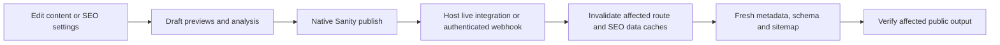

# v0.2 plan: the Yoast experience for Sanity + Next.js

The agent's current ordered work and verification checklist is [EXECUTION-PLAN.md](EXECUTION-PLAN.md). Use it to track completed steps and remaining gates.

2026-10-21 candidate update: rc.2 incorporates the Phase 1–2 stabilization work. Its exact-archive outcome is recorded in `.artifacts/verification.json`, with the current workspace phase record in `reports/phase-3-verification.md`. The descriptions below retain the original planning/rc.1 context; a candidate build is separate from real-project installation and live publication checks.

Priority reassessment: the [2026-10-20 audit](yoast-gap-audit-2026-10-20.md) is the current gap inventory and execution order. Stabilize readiness and release evidence in a new RC, then complete the daily editor experience before adding large advanced systems. The original milestone descriptions below remain implementation context.

Planning date: 2026-10-20. Implementation status: local candidate `0.2.0-rc.1` now contains the settings/tool, editor/social improvements, shared traffic lights, bounded Health/Optimize scans, and advisory Workflow views. CI/release workflow files and upgrade docs are prepared. The live CMS/cache/staged rollout gates below remain open; this is not a stable-release completion claim.

The product goal is to reproduce the useful Yoast experience in WordPress: a recognizable SEO home, site-wide configuration, understandable defaults, page-level search/social editing, separate SEO and readability feedback, and a clear path from finding a problem to fixing it before publication. Sanity and Next.js supply the underlying platform. This is an independently implemented product; matching the experience does not imply identical scoring, linguistic coverage, branding, or every Free/Premium feature.

This plan supersedes the original plan's decision to defer a separate Studio tool. The package remains standalone and reusable across projects, with one version and three entry points: `@gerald/seo/core`, `/sanity`, and `/next`.

## 1. Current version and next-version scope

| Area | Current 0.1.0 | Planned 0.2.0 |
|---|---|---|
| Navigation | SEO fields inside selected documents | A top-level **SEO** tool with Overview, Settings, Health, Optimize, and Workflow sections |
| Onboarding | README and code configuration | First-run checklist showing missing configuration and frontend integration checks |
| Global settings | Public defaults in project code; optional host context loader | Editor-managed defaults with a package settings document or an existing settings integration |
| Search appearance | Content title plus site name; document overrides | Site separator and safe per-content-type title templates, retaining existing behavior by default |
| Document editor | Standard fields, generic previews, individual checks | Search, Social, Advanced, and Analysis sections; inherited values and separate SEO/readability indicators |
| Social | One shared image; search values feed OG/X | Independent social title/description/image overrides and accurate OG/X fallback previews |
| Health | Feedback for the open document | A filterable, paginated overview of configured content and shared site/configuration issues |
| Optimize | Individual advisory messages | A prioritized issue list with source-field links and an explicit editing/recheck loop |
| Workflow | Native Sanity editing/publishing | Needs attention / Incomplete / Ready to review views, with draft/published context and a pre-publication checklist |
| Distribution | Locally packed tarball | Repeatable CI verification, release artifacts, and coordinated consumer upgrades; registry delivery once configured |

Settings, Health, Optimize, and the lightweight Workflow are all included in this release. Advanced automation and broader Yoast parity have explicit later milestones below.

## 2. Studio experience

### SEO home and onboarding

Installing and registering the plugin should make **SEO** visible alongside the Studio's other tools, even when the host supplies a custom Content structure. It must not replace Presentation or the host's navigation. Use supported plugin/tool and structure APIs, and native Sanity document forms for settings editing. [Sanity plugin API](https://www.sanity.io/docs/studio/plugins-api-reference)

Overview shows setup status, counts for the scanned content, actionable problems, and the current package/analyzer versions. First-run setup covers site identity, sharing defaults, selected content types, content-adapter coverage, and frontend installation. Checks that cannot be measured from Studio must be marked **Not verified**, with a concrete verification step.

The initial setup does not create or publish CMS data on plugin startup. Editors explicitly save and publish their settings. SEO is a separate navigation destination from `/presentation`; document SEO remains available while editing in Presentation.

### Global settings

Use one namespaced settings schema and fixed-ID singleton for projects choosing package-managed settings. Provide an integration path for projects with an existing Site Settings singleton; do not require a competing source of defaults. Singleton identity and navigation must be explicit. [Sanity singleton guidance](https://www.sanity.io/docs/studio/create-a-link-to-a-single-edit-page-in-your-main-document-type-list)

| Group | Editable settings |
|---|---|
| Site basics | Site name, default description, language, publisher type/name, publisher logo |
| Search appearance | Title separator, title template per configured document type, type indexing default |
| Social | Default sharing image and alt text; optional default X card/site account |
| Integrations | Read-only production origin, mapped document types, frontend checklist, package version, and settings revision |

Title templates support only documented tokens such as `{title}`, `{siteName}`, and `{separator}`. Reject unknown tokens, collapse empty separators, and prevent duplicate site suffixes. A document's explicit search title remains literal rather than being templated again. Do not add a general expression/template execution engine.

Keep the production origin, route resolvers, custom-block extraction, deployment environment, and credentials in developer configuration. These are integration contracts, not editorial preferences. CMS settings must never turn preview/staging output into indexable production output.

Optional language settings do not imply multilingual readability support. Clearly identify checks unavailable for the selected language.

### Page and post SEO panel

Use familiar sections and direct language:

- **Search:** focus keyphrase, title, description, production URL, desktop/mobile approximate search preview, and inherited-value labels.
- **Social:** optional sharing title/description/image, OG and X previews, and a clear fallback to search/content/site values.
- **Advanced:** canonical URL and inherit/index/noindex controls with explanations of their effect.
- **Analysis:** separate SEO and Readability indicators, expandable problems/improvements/good results, and source-field navigation where the adapter provides a path.

Use red, amber, green, and gray indicators with text/icons so status does not depend on color. Red means a defined high-priority problem; amber means an advisory improvement; green means the applicable implemented checks passed; gray means unknown, incomplete, or unavailable. Define category aggregation in core and test it. Do not present a fabricated percentage or call the result a Yoast score.

Preserve native inputs, keyboard access, unsaved editing, debounce behavior, and stale-response protection. Feedback must not block content editing. Clearing an override restores inheritance without writing inherited text back into the document.

## 3. Health, Optimize, and Workflow

### Health: find the content needing attention

Provide a shared site/configuration summary and a paginated document list, filterable by configured type, publication state, analysis status, and issue category. Each row shows title, intended URL, SEO/readability status, coverage, and an editor link.

Reuse `resolveSeo` and `analyzeSeo`. Add an explicit host loading contract for paginated documents and reference context, using the same project mappings as the editor and frontend. Do not fetch every field of every document, assume `page`/`post` names, or download an entire dataset on each keystroke. Start with an explicit scan and refresh; show scanned counts, scan time, and partial coverage. Only call a total site-wide after completing the scan.

Initial checks include missing resolved metadata or sharing images, invalid/unroutable configuration, unsupported blocks, keyphrase guidance, headings, links, image alt text, and the existing English readability checks. Configuration or resolution failures become visible per-item errors rather than aborting the whole list. Intentional noindex and external canonicals are informational states, not automatic failures.

This is a content/configuration health report. It cannot establish live indexation, ranking, HTTP status, deployed JSON-LD, or production cache freshness. Rendered-output checks belong to the frontend verification pipeline; display their date/environment separately when evidence exists.

### Optimize: turn analysis into edits

Group existing findings by practical priority: missing/invalid output, content coverage, metadata, content structure, and readability. Show the affected field and a specific action. Open the document at that field where possible; otherwise open its SEO panel with an explanation.

The first version guides manual edits using the same native editor. It does not generate AI text, change body copy, batch-patch documents, or publish fixes automatically. There is no second optimizer scoring algorithm. Reanalyze unsaved edits immediately and refresh list results after saves or explicit refresh.

### Workflow: an editorial review path

Provide saved filter views for **Needs attention**, **Incomplete analysis**, and **Ready to review**. Compute these from the current scan and shared checks. Ready to review means all applicable implemented checks passed; it does not assert human approval, search visibility, or publication readiness for every business rule.

The workflow is: open an issue, edit content/overrides, inspect search and social previews, recheck, and use Sanity's normal publication controls. Show whether analysis concerns the draft, published document, or unsaved editor values. Published review uses published settings; draft review may use draft settings and must show that distinction.

Keep this advisory. Do not introduce a second publication status, publish blocker, assignment system, or stored approval flag in 0.2. Sanity permissions remain authoritative. If a later feature persists reviews or analysis, it must track document/settings revisions and analyzer/adapter versions so changes invalidate stale results.

## 4. Shared settings and frontend behavior

One normalized settings contract must drive Studio previews, Health/Optimize, Next Metadata, JSON-LD, sitemap eligibility, and robots policy where applicable. Extend the current context mechanism rather than creating a separate resolver per screen.

Define fallback order explicitly:

1. Nonblank document override.
2. Mapped content value; for titles, apply the configured type template once.
3. Published CMS type/site defaults where applicable.
4. Existing public code defaults.

For indexing, use document policy, then CMS type policy, then the adapter policy, then the existing default. Preview/staging protection always takes priority. Social values use their own override, then resolved search/content/site values. Merge optional settings field by field rather than replacing entire nested groups with incomplete objects.

Missing settings documents are supported and preserve 0.1 behavior. Fetch failures are different from an absent document: report them explicitly rather than quietly producing changed production metadata. Validate all CMS-provided settings at the core boundary because writes can bypass Studio validation.

The package supplies schema, normalized types, projections/mapping helpers, and integration recipes. The host owns its authenticated client, publication perspective, loading, route ownership, and cache policy. Shared public modules must contain no private tokens.

### Content/settings publication pipeline

Document updates invalidate the affected route and sitemap as required; a slug change includes both old and new paths. Unpublish/delete removes public output and sitemap entries. Site-wide setting changes refresh every affected route, settings cache, and sitemap/robots data where relevant. Document the exact implementation against the installed Next/Sanity integration versions; the package cannot invalidate arbitrary host caches by itself.

Acceptance must include a real settings edit/publish and a content edit/publish, with observable draft isolation and public refresh. Fixture builds alone are insufficient evidence for this behavior.

## 5. Implementation sequence and completion gates

| Milestone | Work | Gate before proceeding |
|---|---|---|
| A. Settings contract | Add normalized site/type defaults, template rules, schema/projection helpers, CMS/code merge rules, and validation | Pure tests cover missing/partial settings, bad values, inheritance, title overrides/templates, and preview protection |
| B. SEO home and settings | Register SEO navigation; add settings document/native form, first-run checklist, existing-settings mapping, and settings loading | SEO appears with a custom Content structure; both settings modes work; read-only users can inspect without unauthorized writes |
| C. Editor and frontend | Group document fields; add social overrides/previews; wire new settings through core and Next | The same inputs produce matching preview and public metadata/schema; old documents need no rewriting |
| D. Health and Optimize | Paginated loaders, shared analysis summaries, filters, source links, loading/error/cancel behavior | Both consumer fixtures cover different schemas/routes/blocks; partial scans and unavailable checks cannot appear fully green |
| E. Workflow | Review views, draft/published labels, checklist, edit/recheck flow | An editor can go from finding an issue to editing, rechecking, and native publishing without a separate status system |
| F. Release and first-project upgrade | CI, tarball verification, migration/rollback guide, local Studio integration and public-output checks | The exact release artifact passes package gates and staged consumer checks; evidence and known limits are recorded |

Implementation reaches all affected surfaces together:

- `src/core/types.ts`, `resolve.ts`, `analyze.ts`, and `index.ts`: settings/social contracts, resolution, projections, and category summaries; core stays framework-free.
- `src/sanity/index.tsx` and `input.tsx`, plus focused settings/tool components: registration, schemas, native editing, navigation, and accessible feedback.
- `src/next/index.tsx`: resolved search/social/default settings output without client/Studio imports.
- Existing tests plus settings/tool/scan tests: default compatibility, loading failures, stale results, pagination, status aggregation, and field navigation.
- Both `examples/portable-text` and `examples/custom-sections`: install the packed package, load settings, preserve different mappings, and demonstrate cache integration boundaries.
- `scripts/verify-package.mjs`, package metadata, CI workflows, README, integration reference, changelog, and upgrade guide.
- Consumer Studio/frontend configurations, queries/projections and generated types, dependency lockfiles, route wrappers, and cache invalidation where the new settings are enabled.

Do not modify a consumer's content model or renderer just to fit a package default. The current RUN project is the first integration target, not a hard-coded package assumption.

## 6. Package release and update pipeline

### Distribution prerequisites

This workspace currently has no Git repository or CI workflows, and 0.1.0 is recorded as a local release. Registry ownership/availability of `@gerald/seo` is not confirmed. Establish the repository, package owner, access model, and publishing destination before enabling registry jobs. Do not advertise registry installation until the package is actually available.

Keep a local tarball path operational throughout. A registry simplifies distribution across future projects, but each project still installs and activates the package in both Studio and Next.js.

### Pull request verification

Proposed `.github/workflows/ci.yml`:

1. Install the pinned CI toolchain and run `npm ci` from the committed lockfile.
2. Run `npm run typecheck` and `npm test`.
3. Build and pack once. Refactor package verification to accept that exact tarball instead of independently repacking inside each stage.
4. Inspect its allowlist, exports, declarations, preserved client directives, and framework boundaries. Confirm core imports without framework peers.
5. Install the tarball into both independent consumers; typecheck and build Studio and Next; run HTTP checks for metadata, social output, JSON-LD, canonical/noindex behavior, sitemap, robots, and missing routes.
6. Add settings/draft/coverage scenarios and Studio navigation/component checks; record what is fixture-based versus live CMS verification.
7. Upload the tested tarball, hash, supported/tested version matrix, and verification report as CI artifacts. Failed checks stop release.

Use a Linux runner for the publishing path and retain a Windows verification job for packaging/local-install portability. Start with exact known-good framework versions, then test accepted lower bounds before claiming them. Do not widen peer ranges just because a new framework release exists.

### Release stages

```mermaid
flowchart LR
  CHANGE[Implement and review] --> CI[CI and packed-consumer checks]
  CI --> RC[Versioned release candidate]
  RC --> STAGE[Install in Studio and Next staging]
  STAGE --> LIVE[Verify editor, CMS publish and frontend output]
  LIVE --> FINAL[Build and verify final-version artifact]
  FINAL --> RELEASE[Release artifact and optional registry publish]
  RELEASE --> PR[Consumer upgrade PRs]
  PR --> DEPLOY[Project checks and deployment]
```

Use unique versions such as `0.2.0-rc.1` and publish candidates under `next` only after registry setup. The final `0.2.0` artifact must pass the same checks; do not rename a candidate tarball or assume its earlier verification covers rebuilt output. Publish the exact verified final tarball. Use a reviewed version commit/tag matching `package.json`, changelog, lockfile, and release notes.

For GitHub-hosted publishing, configure npm trusted publishing/OIDC for the designated release workflow, with narrowly scoped permissions and the required Node/npm versions. Eligible trusted-published packages receive provenance. Keep publication credentials out of Studio and application configuration. [npm trusted publishing](https://docs.npmjs.com/trusted-publishers/)

Use npm distribution tags to distinguish candidates from normal installs. Configure the publisher's allowed tag-management actions if the workflow promotes or rolls back a tag; tags point to versions rather than modifying an existing package. [npm distribution tags](https://docs.npmjs.com/cli/commands/npm-dist-tag/)

Until registry distribution is available, attach the uniquely versioned `.tgz`, checksum, and release notes to the release and vendor it in each consumer. The current package allowlist already includes `docs`, so this plan ships with future package builds.

### Updating an installed project

Every upgrade is a normal dependency change, not an in-Studio self-updater:

1. Read the release notes and migration checklist; record the installed versions and current deployment.
2. Open one upgrade change covering the paired apps, or linked changes for separate repositories. Install the same exact package version in both and commit their lockfiles.
3. For tarball delivery, add a new versioned file under each project's `vendor/` and update its dependency path. Avoid replacing a cached tarball under the same version/path.
4. Update shared configuration, settings integration, projections, generated types, and cache hooks called out by the release. Existing settings and content remain in place.
5. Run project typechecks/builds and targeted tests, then verify SEO navigation, unsaved previews, published defaults, social output, indexing, sitemap, and robots in staging.
6. Verify CMS settings publication invalidates public output. Keep production origins in canonicals and preview deployments noindex.
7. Deploy the frontend support and Studio as a coordinated upgrade. Enable new editor-managed settings only after frontend support is deployed; existing code defaults remain the bridge during rollout.
8. Record the package version and verification evidence for that project. Dependency bots may propose later updates, but must not merge/deploy them without the project checks.

After a registry release exists, the dependency update command is `npm install --save-exact @gerald/seo@0.2.0`, run separately in each app. For tarballs, use the corresponding exact `./vendor/gerald-seo-0.2.0.tgz` file instead. These are future upgrade instructions, not commands executed by this plan.

### Rollback and compatibility

Keep the last good package artifact, lockfiles, app deployment, and published settings snapshot available. Roll back both app dependencies/configuration and redeploy; restore settings only if their changed values caused the regression. If the prior plugin cannot describe newly stored fields, retain additive schema definitions or use the documented compatibility mode until those fields can be reviewed safely.

Prefer additive optional fields. Preserve existing SEO field names and values, exports, `seoPlugin({config, loadContext})`, and default output. A new setting must be opt-in or default to existing behavior. Do not bulk-create SEO values, migrate content on startup, or silently republish documents.

Use patch releases for compatible fixes and minor releases for additive features. While pre-1.0, explicitly document any incompatible change and require a migration guide rather than treating the version number as sufficient warning. Pin exact consumer versions. Do not overwrite or reuse published versions; fix a bad release with a new version and move tags as appropriate. [npm publication rules](https://docs.npmjs.com/cli/commands/npm-publish/)

## 7. Later milestones toward the Yoast experience

| Target | Additions | Dependency / boundary |
|---|---|---|
| 0.2.x | Fixes and authoring polish from the first real integration | Keep defaults and stored content compatible |
| 0.3 | Cornerstone-content support, internal-link/orphan-content guidance, more adapter presets, deeper content review | Requires explicit cross-document coverage and useful linking data; never equate missing scan data with orphaned content |
| 0.4 | Slug-change redirect workflow, redirect validation, fuller schema/search-appearance controls and real-project robots/locale needs | Redirects need working frontend/runtime activation and cache handling; schema requires factual fields |
| Later / requirement-driven | More languages and linguistic rules, synonym/multiple-keyphrase support, optional AI suggestions, editorial assignments/approvals | Validate analysis coverage; AI uses an authenticated server with explicit application; reuse native editorial workflow where suitable |
| 1.0 gate | Stable public contracts, documented migration policy, dependable updates, representative real-project verification, and a clear parity matrix | Release when the experience is reliable, not when a feature count is reached |

Maintain a parity checklist linking each observed Yoast behavior to its Sanity UI, core behavior, Next output, test, and implemented/partial/deferred status. Refer back to `YOAST-ANALYSIS.md`; investigate additional behavior when the shipped-artifact evidence is incomplete. Avoid copying subscription infrastructure, WordPress hooks, or branding that does not serve the Sanity experience.

## 8. v0.2 release definition

The release is complete when a supported fresh project can install the package in both apps, discover SEO settings without reading source code, publish shared defaults, see matching document previews/public output, find issues through Health, work through Optimize/Workflow, and upgrade or roll back using the documented process. A second project with different types/routes/blocks must do the same without editing package source.

Required live sign-off covers a settings publication, content publication, unpublish/delete or route change, preview isolation, and observable public refresh. Record anything not checked. No registry publication, application deployment, or new runtime functionality is performed by this planning document.
