# Yoast feature-gap and release-pipeline audit

To execute these findings, follow [the numbered implementation and verification checklist](EXECUTION-PLAN.md). This audit supplies evidence and priorities; the checklist tracks the work.

Date: 2026-10-20. Product target: reproduce the useful **Yoast experience in WordPress** as a reusable Sanity + Next.js plugin.

The primary reference is the extracted **`plugins/` folder**, not another Sanity plugin or a generic SEO checklist. Its entry file identifies Yoast SEO **28.7**. `plugins/wp-seo.php` SHA-256: `abf3c51882ab0ac122e9ec36d7182232ca5727364a6f3d9e98fc5795e6e4ca29`. Distribution provenance was not independently authenticated. Comparison target: our **0.2.0-rc.1** current source and local archive.

Three parallel reviews covered editor/analysis, technical/settings behavior, and release/update delivery. Findings below combine those reviews with direct source checks and bounded local probes. Public documentation supplements the extracted copy only where Premium, service, or current-platform boundaries need clarification. No WordPress instance, paid service, live CMS publication, or hosted CI was exercised.

## Main conclusion

Our package has a solid singular-page output foundation and the main navigation surfaces. It does **not yet reproduce the complete Yoast authoring experience**. The most significant differences are analysis depth and eligibility, actionable snippet editing, separate network controls, cross-document awareness, guided setup/tasks, and durable scan/review state.

Health, Optimize, Workflow, Settings, previews, canonical support, basic schema, and sitemap/robots helpers are **present**. Calling these wholly missing would be wrong. Calling them equivalent to Yoast would also overstate the implementation. In particular:

- Our social overrides are independent of search metadata, but **one shared social object feeds both Open Graph and X**. Independent per-network overrides are still missing.
- Our Optimize screen is a prioritized advisory list. Yoast's **SEO data optimization** rebuilds its indexable data; copying its database architecture is not the appropriate Sanity implementation.
- Workflow currently provides derived review filters and a checklist. It does not yet implement Yoast-style actionable tasks/workouts. Custom assignments, approvals, and publish blockers are separate product choices, not required evidence of Yoast parity.
- A green editor result is not evidence of deployed HTML, cache freshness, indexation, or ranking.

This is a comprehensive inventory within the named feature families and supplied artifact, with conditional targets explicitly marked. It is not an assertion that every Yoast edition, paid endpoint, future release, or vendor integration was exhaustively exercised. Counts are inventory entries, not a percentage of parity or development effort.

## Fix before expanding the feature set

| ID | Priority | Finding | Evidence and smallest complete correction |
|---|---|---|---|
| R01 | P0: stable-release gate | **Heading-only content can receive green readability and Ready to review.** | A direct probe supplied one H1, zero paragraphs/sentences, valid title/description/image. `reviewSeoDocument` returned `seo: good`, `readability: good`, `state: ready`. `src/core/analyze.ts:30` counts headings as text, then lines 81–84 add successful readability checks without prose. Require eligibility per assessment; absent prose/sentences must be unavailable, with regression coverage. Do not force every page to have long body copy. |
| R02 | P0: stable-release gate | **The release gate accepts documentation/fixture drift.** | The rc.1 archive matches its recorded checksum and packed runtime matches current source. However, its README/upgrade guide differ from current files, and tested consumer configs differ from current examples after the Content/SEO tab changes. `scripts/check-release.mjs:12-21` still passes. Preserve the distributed rc.1; finalize and verify **rc.2**, binding the report to source and fixture identities. |
| R03 | P0: stable-release gate | **A later failed verification can leave the old success report usable.** | `verify-package.mjs` writes `verification.json` only at the end and never invalidates it at startup/failure. A failure before repacking or while rechecking an unchanged archive can leave a prior report accepted by standalone `check-release`. Existing CI stops on a failing step, so this is **not an automatic CI bypass**. Invalidate old success at start; write success atomically and verify its inputs. This finding is code-derived, not an intentionally executed failure. |
| R04 | P0: stable-release gate | **Real publication, settings, permission, and cache behavior is not signed off.** | Fixture HTTP checks use local static settings. Mocked listener tests cannot establish authenticated Sanity editing/publishing or live Next invalidation. Complete the real staged edit → draft preview → publish → matching public output loop before stable promotion. |
| R05 | P1: daily experience | **Health, Optimize, and Workflow do not share a scan session.** | Separate component nodes are registered in `src/sanity/index.tsx:29-30`; reviews/cursor/filters/perspective are component-local in `dashboard.tsx:17-29`. Native pane remount behavior was not browser-tested, but no shared scan model exists. Use one SEO workspace/session so issue → edit → review does not require restarting separate scans. |
| R06 | P1: daily experience | **Saved document edits leave scan rows stale until explicit refresh.** | Only settings/perspective/options reset the dashboard; it explicitly documents manual refresh at `dashboard.tsx:91`. This is a disclosed limit, not hidden corruption. Detect affected revisions and recheck/mark stale on return before adding more dashboards. |

P0 means fix or prove before calling 0.2 stable. P1 means the next core Yoast-experience milestone. P2 follows once the editor loop and shared content model are reliable. P3 is optional/service-specific or applies only to a consumer with the corresponding route/content needs.

## Feature-gap catalog

Status **Partial** means an underlying capability exists but the named experience is incomplete. **Missing** means no corresponding implementation was found in our inspected public source. **Conditional target** means a documented paid/service/advanced target or an activation boundary not established by the base artifact; it is not counted as a proven unlocked Free feature.

Evidence keys Y01–Y18 and O01–O06 are defined below. Bundled JavaScript references use symbol/module anchors rather than treating a minified line as proof of runtime activation.

### A. Search editing, SEO analysis, and readability

| ID | Priority | Status | Feature | What is missing or incomplete | Evidence |
|---|---|---|---|---|---|
| A01 | P1 | Partial | Search snippet editor and device previews | Current preview changes card width; missing closer snippet layout/truncation and integrated snippet editing. | Y01, Y02; O02 |
| A02 | P1 | Missing | Measured SEO title-width guidance | We use character counts; no browser measurement, width meter, or calibrated result-width feedback. | Y02 titleWidth; O01 |
| A03 | P1 | Missing | Editor template-variable picker | No variable insertion/available-token guidance in document search fields; document title overrides remain literal. | Y01, Y07; O02, O04 |
| A04 | P1 | Partial | Distinct Problems / Improvements / Good results | Our UI combines problems and improvements despite calculating different priorities. | Y02; O01, O02 |
| A05 | P1 | Partial | Separate calibrated SEO/readability assessment aggregation | We have separate lights, but aggregate warnings with simple rules rather than calibrated assessment applicability/weights. Do not copy an unverified numeric score. | Y02; O01 |
| A06 | P1 | Partial | Keyphrase-analysis readiness | Missing keyphrase is informational, so green may mean keyphrase analysis was never performed. Show not-started/not-applicable distinctly; do not require a focus phrase for every page purpose. | Y02, Y05; O01 |
| A07 | P1 | Missing | Keyphrase length and function-word checks | No length/meaningful-word assessment. | Y02 keyphraseLength/functionWordsInKeyphrase; O01 |
| A08 | P1 | Missing | Keyphrase density | No frequency/overuse assessment. | Y02 keyphraseDensity; O01 |
| A09 | P1 | Missing | Keyphrase in subheadings | Heading-order checks exist; phrase use in subheads is not evaluated. | Y02 subheadingsKeyword; O01 |
| A10 | P1 | Missing | Keyphrase in image alt text | Alt presence exists; topical phrase/image relationship is not assessed. | Y02 imageKeyphrase; O01 |
| A11 | P2 | Missing | Content image presence/count guidance | No document-purpose-aware image coverage assessment. | Y02 images; O01 |
| A12 | P1 | Missing | Internal-link presence | We validate supplied links but do not assess whether internal links are present. | Y02 internalLinks; O01 |
| A13 | P1 | Missing | Outbound/followed-link assessment | No internal/external/followed distinction or absence assessment. | Y02 externalLinks; O01 |
| A14 | P2 | Missing | Competing keyphrase anchors | No warning about links using the target phrase as a competing anchor. | Y02 textCompetingLinks; O01 |
| A15 | P2 | Missing | Previously used focus keyphrases | No cross-document phrase reuse/conflict query or filter. | Y02, Y05; O01, O03 |
| A16 | P1 | Partial | Title/description/intro/slug keyphrase rules | Present as exact normalized contiguous matching; missing richer matching, function-word handling, and graded feedback. | Y02, Y03; O01 |
| A17 | P1 | Partial | Text length by content purpose | One advisory 300-word reference; no normal/taxonomy/cornerstone profiles or purpose-specific applicability. | Y02; O01 |
| A18 | P1 | Missing | Passive-voice analysis | No passive-voice rule or supported-language calibration. | Y02 passiveVoice; O01 |
| A19 | P1 | Missing | Transition-word analysis | No transition-word rule or supported-language calibration. | Y02 textTransitionWords; O01 |
| A20 | P0 | Partial | Readability/text eligibility | Heading-only content can pass prose checks; see R01. | Y02 textPresence; O01 |
| A21 | P1 | Partial | Existing readability rules | Sentence/paragraph length, long sections, repeated beginnings exist; thresholds, score bands, and applicability remain simplified. | Y02; O01 |
| A22 | P1 | Missing | Exact text highlighting | Field links exist; no marking of affected words/sentences in Portable Text/custom blocks. | Y02 markAssessment; O02 |
| A23 | P2 | Partial | Content Insights | Word count exists; no reading time, Flesch Reading Ease display, or relevant term insights with explicit applicability. | Y02 Insights paths; O01 |
| A24 | P2 | Missing | Inclusive-language analysis/preferences | No matching rule family or global/user enablement. Supplied implementation has language/version gates. | Y03; O01, O04 |
| A25 | P2 | Partial | Language-specific research | Tokenization accepts language tags, but readability is English-only and we do not implement Yoast's language researchers/word-form coverage. | Y03; O01 |
| A26 | P3 | Conditional target | Multiple/related keyphrases | One focus phrase only. Advanced related-keyphrase paths are bundled; Premium product support requires entitlement distinction. | Y02, Y17; O05 |
| A27 | P3 | Conditional target | Synonyms and word forms | No synonym/form matching model. Bundled language helpers are not evidence every advanced mode is Free-enabled. | Y02, Y03, Y17; O01 |
| A28 | P3 | Conditional target | Keyphrase distribution | No distribution-across-text assessment. Export exists outside the default assessor list. | Y02, Y17; O01 |
| A29 | P3 | Conditional target | Word complexity | No complexity assessment. Bundled advanced exports do not prove default activation. | Y02; O01 |

### B. Social editing, site structure, dashboards, and workflow

| ID | Priority | Status | Feature | What is missing or incomplete | Evidence |
|---|---|---|---|---|---|
| B01 | P1 | Partial | Independent Open Graph and X overrides | Our shared social object drives both. Missing per-network title/description/image overrides and fallback provenance. | Y01; O02, O05, O06 |
| B02 | P1 | Partial | Platform-specific social previews | Cards are largely identical; missing platform-appropriate layouts/truncation. Supplied fields do not establish paid preview entitlement. | Y01; O02 |
| B03 | P2 | Conditional target | Per-type social appearance templates | No social title/description/image template per content type. Public documentation identifies paid template functionality. | Y07, Y17; O04 |
| B04 | P2 | Missing | Cornerstone switch and filters | No authored cornerstone flag or corresponding lists. | Y01, Y04; O02, O03 |
| B05 | P2 | Missing | Cornerstone analysis profile | No stricter cornerstone SEO/readability profile, independent of the switch. | Y02, Y04; O01 |
| B06 | P2 | Missing | Incoming/outgoing internal-link counts | No cross-document graph or native list counts. Per-link validation is not a link counter. | Y05; O01, O03 |
| B07 | P2 | Conditional target | Internal-link suggestions | No suggested target/content relationships. Requires a complete shared graph and content coverage first. | Y02, Y17; O03, O05 |
| B08 | P2 | Conditional target | Cornerstone/orphan-content workouts | No guided choose/check/update/add-links sequence. Workouts in the supplied copy have Premium gates. | Y04, Y17; O03 |
| B09 | P2 | Conditional target | Orphan/stale-content review | No editorial orphan/stale-cornerstone filters. Exact paid stale-content behavior is not established by a cleanup routine's name. | Y04, Y17; O03 |
| B10 | P1 | Missing | Indicators in native content lists | SEO/readability/keyphrase metadata is visible only in our editor/tool, not native Page/Post lists. | Y05; O02, O03 |
| B11 | P2 | Partial | Direct score/keyphrase sorting/filtering | Tool filters type/review-state/category; missing separate SEO/readability state filters, phrase filters, and corresponding native-list navigation. | Y05; O03 |
| B12 | P1 | Partial | Shared dashboard state | Each screen has its own scan state; no common result set or preserved navigation context. | Y06; O03; R05 |
| B13 | P2 | Missing | Actionable persistent tasks | Missing setup/template/recent-content task queues, completion, priority, and relevant next action. | Y06; O03 |
| B14 | P2 | Missing | Alert center with dismissal/restoration | Only transient errors exist; no persistent issues/alerts with user resolution. | Y06; O03 |
| B15 | P2 | Missing | Widespread default-data alerts | No site-level pattern/default-use counts or configurable assessment of whether that is intentional. | Y06; O03 |
| B16 | P1 | Partial | Resumable reanalysis and freshness | Explicit 25-document pages exist; missing shared/resumable progress and content/settings/adapter/analyzer revision tracking. Yoast indexable rebuild is not content rewriting. | Y06; O03; R06 |
| B17 | P2 | Missing | Safe bulk title/description editing | No select/edit/review/save workflow for multiple documents. Use native permissions, revision conflict checks and explicit application; never silently publish. | Y12; O03 |

### C. Global settings and route-context coverage

| ID | Priority | Status | Feature | What is missing or incomplete | Evidence |
|---|---|---|---|---|---|
| C01 | P1 | Partial | Guided first-run configuration | Text checklist exists; no saved steps, completion state, or integrated verification of frontend/settings publication. | Y06, Y07; O03 |
| C02 | P2 | Missing | Site-wide feature preferences | No explicit enable/disable preferences for SEO/readability/Insights/cornerstone/schema/social/sitemap modules, with coherent output behavior. | Y07; O04 |
| C03 | P1 | Partial | Type-specific descriptions | Only type title/indexing settings; no type description defaults/templates. | Y07; O04, O05 |
| C04 | P1 | Partial | Rich safe replacement variables | Only title/siteName/separator; no adapter-backed excerpt/page/author/date/type terms or visible unsupported-token guidance. | Y07; O04, O05 |
| C05 | P1 | Partial | Homepage-specific defaults | A homepage document can have overrides; no distinct global homepage search/social appearance configuration. | Y07; O04 |
| C06 | P2 | Missing | Taxonomy/category/tag appearance | Generic adapters can represent these documents, but there are no presets/settings for their archives and defaults. | Y07, Y08; O04, O05 |
| C07 | P2 | Missing | Author/date/archive contexts | No packaged route context/defaults/enablement for real archive routes. Do not create unused archives merely to reproduce a menu. | Y07, Y08; O05 |
| C08 | P1 | Missing | Search/404 context policy | No explicit context model with search/404 templates and safe default indexing rules; host can only construct manual synthetic adapters. | Y08; O05, O06 |
| C09 | P1 | Missing | Pagination-aware SEO | No page/total context, page token, or canonical policy for path/query pagination; production path helper currently rejects query routes. | Y07, Y08; O05 |
| C10 | P1 | Partial | Site and publisher identity | Missing alternate site/publisher names, public publisher URL, sameAs profiles, and fuller factual author identity. Basic name/type/logo exists. | Y09; O04, O05, O06 |
| C11 | P1 | Missing | Site-verification settings/output | No package contract for Google/Bing/Yandex/Baidu/Ahrefs/Pinterest verification codes. Next can support host-written tags, but that is not our settings feature. | Y18; O04, O06 |
| C12 | P2 | Partial | Advanced-setting permissions | Native Sanity permissions apply, but no effective-permission setup/diagnostics for global settings versus document SEO. UI hiding is not server authorization. | Y07; O02, O04 |
| C13 | P2 | Missing | Portable settings export/import | No SEO-only versioned settings envelope, review/diff, or cross-project asset mapping. Generic dataset export is a different workflow. | Y12; O04 |
| C14 | P2 | Missing | Yoast content migration mapping | No importer for Yoast metadata, cornerstone flags, hierarchy, canonical/indexing policies, or redirect history. Start with Yoast-to-Sanity, not every WP-to-WP importer. | Y01, Y12; O05 |
| C15 | P3 | Missing | Feed attribution/settings | No RSS integration or before/after attribution. Add only for consumers that actually provide feeds. | Y08; O06 |

### D. Public output, structured data, discovery, and crawler controls

| ID | Priority | Status | Feature | What is missing or incomplete | Evidence |
|---|---|---|---|---|---|
| D01 | P1 | Partial | Advanced page robots directives | index/noindex exists; follow is fixed true and max-preview values are fixed. Missing nofollow, nosnippet, noimageindex and configurable supported preview limits. | Y08; O05, O06 |
| D02 | P2 | Partial | Structured robots user-agent rules | Wildcard allow/disallow and preview protection exist; no per-agent rules or multiple sitemap sources. | Y08; O06 |
| D03 | P1 | Partial | Explicit public-content eligibility | We exclude draft/release IDs, not arbitrary private/gated content. Host query/adapter must own and prove publication eligibility. Noindex does not secure private data. | Y11; O05, O06 |
| D04 | P1 | Partial | Schema choices by type/document | Only page/article adapter kinds. Missing content-appropriate page/article subtype choices and a Studio Schema section/defaults. | Y01, Y09; O02, O04, O05, O06 |
| D05 | P2 | Partial | Rich connected schema graph | Missing shared primary ImageObject/author IDs and several factual date/author/word-count relationships. Basic graph is already present. | Y09; O06 |
| D06 | P2 | Missing | Typed graph extension contract | Host can post-process JSON-LD manually, but no documented extension/validation/deduplication contract. | Y09; O06 |
| D07 | P1 | Partial | Breadcrumb authoring and visible renderer | JSON-LD accepts adapter trails; missing title overrides, primary hierarchy/category/parent choices, display settings, and accessible visible Next breadcrumbs from the same trail. | Y01, Y10; O05, O06 |
| D08 | P2 | Missing | FAQ/HowTo content-to-schema adapters | No matching structured sections/steps/questions integration. Require real visible content, not raw schema-only decoration. | Y09; O05, O06 |
| D09 | P2 | Partial | Sitemap index and batched providers | Flat sitemap helper exists; no index/large-site batching/type/archive provider contract. Keep small-site path simple. | Y11; O06 |
| D10 | P2 | Partial | Meaningful content images in sitemap | Only one resolved SEO image is emitted; content image nodes do not carry URLs for a complete eligible-image list. | Y11; O05, O06 |
| D11 | P3 | Missing | Optional llms.txt | No deterministic export, manual/automatic selection, or freshness integration. Not evidence of AI visibility/ranking. | Y15; O06 |
| D12 | P3 | Missing | Schema aggregation/schemamap endpoints | No site-wide JSON/XML graph discovery endpoint. Supplied feature is conditional/default-disabled, so not a core-release blocker. | Y15; O06 |
| D13 | P3 | Missing | Public head/metadata API | No Yoast-style get-head-for-URL or REST metadata representation. Existing pure core/Next helpers cover our current frontend use case. | Y16; O05, O06 |
| D14 | P3 | Missing | Enhanced Slack sharing data | No author/reading-time label tags. OG/X basics already exist. | Y16; O06 |
| D15 | P3 | Conditional target | IndexNow submission | Flag exists in supplied copy and public docs identify paid functionality; working delivery was not established in the inspected base tree. Our publication pipeline has no submission client. | Y07, Y17; O06 |
| D16 | P3 | Conditional target | Dedicated AI-crawler controls | Base options name CCBot/Google-Extended/GPTBot; enforcement in the supplied base copy is not proven. Our robots helper has no explicit feature for these policies. | Y08; O06 |

### E. Paid and externally connected product targets

| ID | Priority | Status | Feature | What is missing or incomplete | Evidence |
|---|---|---|---|---|---|
| E01 | P3 | Conditional target | AI title/description/social suggestions | No authenticated generation service, consent/usage handling, or apply/revert workflow. Local source contains request/entitlement/UI paths, not a verified model service. | Y13; O02 |
| E02 | P3 | Conditional target | AI assessment fixes | No suggestion/apply flow. Bundled upsell/apply paths do not prove working paid service access. | Y13; O02 |
| E03 | P3 | Conditional target | AI content planning/outlines | No topic/intent/outline pipeline. Requires independent server-side integration and explicit editor application. | Y13; O03 |
| E04 | P3 | Missing | Semrush keyphrase research | No authorized account/API integration; independent of local keyword checks. | Y14; O02 |
| E05 | P3 | Missing | Wincher rank tracking | No authorized tracking connection, account state, or metrics. | Y14; O03 |
| E06 | P3 | Missing | Search Console/GA4 metrics | No connected top queries/pages or organic sessions. In Yoast these depend on onboarded/connected Site Kit/Google data. | Y14; O03 |
| E07 | P2 | Conditional target | Redirect manager and slug-change prompts | No maintained redirect records, change prompts, status selection, loop/duplicate validation, or activated Next/runtime redirects. Premium docs establish the target; a Free upsell page does not establish the paid engine in this copy. | Y17, Y08; O05, O06 |

## Adjacent targets and things to translate rather than copy

These are not omitted silently from the audit:

| Area | Disposition |
|---|---|
| Local / News / Video / WooCommerce SEO | Separate product/add-on integrations, not proven to be implemented by this extracted base plugin. Ours has no dedicated location/opening-hours/map model, news publication sitemap, video sitemap/schema pipeline, or product/catalog SEO adapter. Scope these per consumer rather than counting every commercial bundle item as a base-plugin defect. |
| Multilingual/hreflang | Ours has a language value but no alternate-language route map. A useful Sanity integration gap; WPML compatibility in the supplied copy is not proof Yoast core independently manages all hreflang. Add when a real multilingual route contract exists. |
| WordPress header/feed cleanup | RSD/WLW/oEmbed/shortlink/emoji/pingback and WP feed toggles usually target output Next.js never creates. Inspect actual host output before implementing any equivalent. |
| Search spam/crawl cleanup | Adapt query normalization and route handling only for actual Next search features; avoid copying broad character/emoji bans or blanket homepage redirects. |
| Attachment/author/date archive redirects | WP generates routes that Next may never have. Preserve old URLs during migration; do not create routes just to disable them. |
| Raw robots/.htaccess file editor | Replace with validated structured settings and deployment integration. No arbitrary server-file editor is needed in Studio. |
| Indexables ORM, WP cron/transients/migrations | Replace with deterministic core resolution, revision-aware analysis, host caching, and resumable scans. A second SEO database is not a parity requirement. |
| Gutenberg/Elementor/ACF/WPML/plugin hooks | Translate the editorial need to Sanity content adapters, document actions, Presentation, and Next wrappers. Do not recreate WordPress APIs. |
| MyYoast licensing, upsells, newsletters, telemetry, training menu | Not part of the desired SEO experience unless separately requested. |
| Custom assignments/approvals/publish blockers | Not demonstrated core Yoast workflow requirements. Keep out of the roadmap until the actual editorial process needs them. |
| Obsolete Google search features | Do not prioritize noarchive or SearchAction searchbox parity merely because old source emits it. Google no longer uses noarchive for a cache link, and removed the sitelinks searchbox UI in 2024. [Robots specification](https://developers.google.com/search/docs/crawling-indexing/robots-meta-tag), [searchbox removal](https://developers.google.com/search/blog/2024/10/sitelinks-search-box) |

## Re-evaluated delivery/update pipeline

Our current automation has useful protections: separate framework exports, a packed-file allowlist, core without framework peers, two independent schema fixtures, HTTP metadata/social/noindex/sitemap/robots checks, an exact archive checksum, publication disabled by default, tag/version agreement, and coordinated upgrade/rollback instructions. Retain them.

The pipeline is prepared locally, not established as a running hosted release system. There is no Git repository/remote or configured npm publisher in this workspace. The current report proves specific fixture builds and responses, not an editor-to-production lifecycle.

| Priority | Gap | Required update |
|---|---|---|
| P0 | False readability readiness | Add eligibility regression tests before treating traffic lights as a release-quality signal. |
| P0 | Source/docs/example drift | Freeze rc.1. Complete changes under rc.2 and verify after all source/docs/fixtures are finalized. Record immutable source and input identities. |
| P0 | Stale standalone success report | Invalidate at start/failure; atomically write a successful report; reject mismatched source/fixture identities. |
| P0 | Live lifecycle not signed off | Require one real staged editor/settings/publication/cache/permissions acceptance record before stable release. |
| P1 | Persistent merged fixture directories | Use clean isolated fixtures. Current recursive copy can retain deleted fixture files. |
| P1 | Fixture dependency drift | Root uses npm ci, but fixtures have no lockfiles and use npm install with flexible tooling ranges. Lock supported fixture dependencies and record actual installed peers. |
| P1 | Sparse verification report | Record UTC time, source commit/hash, archive hash, fixture hashes/names, OS, Node/npm/framework versions, unit-test/check outcomes, and separate live staging evidence. Verify expected fixture identities rather than any two success records. |
| P1 | CI and distribution unactivated | Establish remote/repository metadata/scope ownership; run Linux/Windows CI; configure bootstrap and trusted publishing. Assert/log npm version and exact publisher workflow/environment permissions. [npm trusted publishing](https://docs.npmjs.com/trusted-publishers/) |
| P1 | Accepted ranges wider than checked versions | Test one lower-bound combination or narrow support claims. Do not add an unnecessarily huge compatibility matrix. |
| P1 | Cross-screen scan loss/stale rows | Share session state and revision-qualified freshness; recheck affected documents on return. Avoid persisting permanent scores until needed. |
| P2 | Partial cancellation | Document loader gets AbortSignal, but loadContext does not. Late results are discarded correctly; context requests can continue. Add an optional context argument carrying a signal without breaking existing callbacks. |
| P2 | Promotion not linked to all sign-offs | Require successful CI for the same source plus staging acceptance; prepare the final-version artifact and verify it again, then publish that exact archive. |

Recommended flow:

```mermaid
flowchart LR
  S[Versioned source and finalized docs] --> T[Typechecks and regression tests]
  T --> P[Pack one immutable archive]
  P --> C[Two clean locked consumers on Windows and Linux]
  C --> E[Report bound to source inputs and archive hash]
  E --> R[Same RC in Studio and Next staging]
  R --> L[Real edit preview publish unpublish route/cache checks]
  L --> F[Final-version artifact verified again]
  F --> U[Publish or vendor exact archive]
  U --> A[Coordinated exact consumer upgrades and rollback evidence]
```

### Required real-project acceptance

1. A read-only user can inspect appropriate fields without being able to mutate restricted settings; an authorized editor can save and publish the intended fields.
2. An unsaved content edit updates editor analysis without losing edits or applying stale asynchronous results.
3. Draft settings are identified as drafts. Public metadata continues using published settings until publication.
4. A settings publication updates affected public titles/descriptions/social/schema and sitemap eligibility without leaking drafts.
5. Content publication, unpublish/delete, and slug changes refresh affected old/new routes and sitemap entries. Verify actual host cache integration rather than assuming a fixture proves it.
6. Health → affected field → edit → return/recheck → publish works as one useful loop; incomplete adapters cannot appear fully green.
7. Preview/staging remains noindex and public machine endpoints remain published-only.
8. A paired Studio/Next dependency rollback restores the previous app behavior without deleting authored SEO data.

No registry publishing or production self-updater inside Studio is required. Continue normal dependency changes and lockfiles in both apps. A release notification or dependency bot may propose upgrades; it should not install into deployed projects automatically.

## Reprioritized roadmap

| Order | Milestone | Deliverables and exit condition |
|---|---|---|
| 1 | **0.2 stabilization / rc.2** | Fix R01–R04; freeze prior archives; bind reports to source/fixtures; validate current Content/SEO tab guidance; complete actual CMS/settings/cache acceptance. No new dashboard labels. |
| 2 | **Core daily Yoast editor experience** | Shared scan session/freshness, proper severity groups, snippet/token/width editing, stronger default keyphrase/link/image rules, readability eligibility/passive/transitions, separate OG/X values. Add type descriptions, essential identity/verification and supported directives as coherent output/UI changes. |
| 3 | **Site structure and useful tasks** | Native list indicators, cornerstone flag/profile, duplicate phrases, incoming/outgoing links, prioritized tasks/alerts, resumable analysis. One shared identity/reference model powers them. |
| 4 | **Content maintenance and migration** | Cornerstone/orphan workouts and link suggestions after graph coverage is measurable; redirect/slug-change workflow with real runtime activation; portable settings and Yoast migration mapping; richer breadcrumbs/schema and real archive/pagination contexts. Redirects move earlier for a consumer actively changing URLs or migrating an existing site. |
| 5 | **Advanced/optional** | Calibrated additional languages, synonyms/related phrases/distribution/complexity, optional AI and connected metrics, llms/schema discovery exports, and actual Local/News/Video/Product consumer needs. |
| 6 | **1.0** | Stable public/stored contracts, reliable installs and paired upgrades/rollback, representative real-project acceptance, and an honest maintained parity checklist. Full commercial Yoast parity is not a prerequisite for a reliable 1.0. |

This revises the old priority order: do not jump directly from menu creation to AI, many schema types, or a separate approval engine. First make the daily **edit → analyze → fix → publish → correct public output** loop reliable and visibly useful.

## Evidence index

References are repository-relative. PHP paths identify executable definitions/callers; bundle anchors identify static code, not runtime entitlement. Ours was checked from current source, not README claims alone.

- **Y01 — fields/social/schema/cornerstone:** `plugins/inc/class-wpseo-meta.php:98-195` and `:241-273`; post editor bundle `plugins/js/dist/post-edit.js` snippet/measurement paths.
- **Y02 — actual assessor construction:** `plugins/js/dist/externals/analysis.js`, anchor `this.type="SEOAssessor"` constructs 17 default SEO assessments; `this.type="contentAssessor"` constructs seven default readability assessments. Advanced exports such as keyphraseDistribution/wordComplexity are outside these default arrays. Worker anchors `createSEOAssessor`, `createContentAssessor`, `createRelatedKeywordsAssessor`; text marking anchor `markAssessment`; Insights anchors `setEstimatedReadingTime` and `setFleschReadingEase` in post-edit bundle.
- **Y03 — language/inclusive:** `plugins/src/helpers/language-helper.php:18-71`; `plugins/src/editors/framework/inclusive-language-analysis.php:61-99`. Word-form helper lists 20 locales; applicability differs by assessment.
- **Y04 — cornerstone/workouts:** `plugins/src/editors/framework/cornerstone-content.php:36-37`; `plugins/admin/filters/class-cornerstone-filter.php:18-38,112-143`; `plugins/src/integrations/admin/workouts-integration.php:81-90,155-172`; `plugins/js/dist/workouts.js`, anchor `j={cornerstone:[b,v,M],orphaned:[B,_,A]}`. Static paid gates remain paid gates.
- **Y05 — native lists/links/reuse:** `plugins/admin/class-meta-columns.php:112-132,152-229,261-308,347-349,668-683`; `plugins/src/integrations/admin/link-count-columns-integration.php:169-185,236-240`; `plugins/src/editors/framework/previously-used-keyphrase.php:18-26`.
- **Y06 — dashboard/tasks/alerts/indexable refresh:** `plugins/src/dashboard/application/configuration/dashboard-configuration.php:128-151`; `plugins/src/task-list/application/tasks/improve-content-seo.php:122-153`; `plugins/src/task-list/user-interface/tasks/complete-task-route.php:127-157`; `plugins/src/alerts/user-interface/resolve-alert-route.php:61-95`; `plugins/src/alerts/application/default-seo-data/default-seo-data-alert.php:128-142`; `plugins/src/presenters/admin/indexing-notification-presenter.php:58-59,87-96`; `plugins/src/routes/abstract-indexation-route.php:24-34`.
- **Y07 — settings/configuration/templates:** `plugins/src/routes/first-time-configuration-route.php:88-190,260-282`; `plugins/src/actions/configuration/first-time-configuration-action.php:260-299`; `plugins/inc/options/class-wpseo-option-wpseo.php:44-82`; `plugins/inc/options/class-wpseo-option-titles.php:35-73,96-138`; `plugins/inc/class-wpseo-replace-vars.php:332-630,759-813,971-1229`.
- **Y08 — contexts/robots/feed/cleanup:** `plugins/src/presentations/indexable-presentation.php:294-320`; `plugins/src/presentations/indexable-post-type-presentation.php:72-88,147-173,309-340`; `plugins/src/presentations/indexable-search-result-page-presentation.php:17-22`; author/date archive presentations; `plugins/src/integrations/front-end/robots-txt-integration.php:75-124,145-180`; `rss-footer-embed.php:48-50`; `feed-improvements.php:56-62`; `redirects.php:103-108,134-206`; crawl-cleanup implementations.
- **Y09 — schema:** `plugins/src/config/schema-types.php:16-52`; `plugins/src/generators/schema-generator.php:48-112,219-322`; `plugins/src/generators/schema/{website,organization,person,webpage,article,main-image,faq,howto}.php`. Inspect factual node construction, not just option names.
- **Y10 — breadcrumbs:** `plugins/src/generators/breadcrumbs-generator.php:94-194,223`; `plugins/src/presenters/breadcrumbs-presenter.php:52-107,245`; `plugins/inc/options/class-wpseo-option-titles.php:65-73`.
- **Y11 — sitemaps:** `plugins/inc/sitemaps/class-sitemaps.php:121-129,597-606`; post-type provider `:599-618,681-682`; author provider `:20-26,36-79`; taxonomy provider `:64-167`.
- **Y12 — administration/import/bulk editing:** `plugins/admin/pages/tools.php:24-44`; `plugins/admin/class-bulk-editor-list-table.php`; title/description list-table classes; `plugins/admin/ajax.php:91-111,225`; `plugins/admin/class-export.php:41-53,81-87`; `plugins/admin/import/class-import-settings.php:48-102`; importer implementations under `plugins/admin/import/plugins/`.
- **Y13 — AI boundaries:** `plugins/src/ai/generator/user-interface/get-suggestions-route.php:80-128`; AI generator integration subscription/consent state `:173-199`; content planner suggestions `:73-128`; outline route `:176-194,228-240`. Remote model behavior and paid access were not exercised.
- **Y14 — external metrics/research:** Semrush/Wincher routes, clients and actions; `plugins/src/dashboard/application/search-rankings/top-query-repository.php:58-66`; `traffic/organic-sessions-daily-repository.php:58-66`. Connected account prerequisites apply.
- **Y15 — llms/schema discovery:** `plugins/src/llms-txt/`; `plugins/inc/options/class-wpseo-option-llmstxt.php:30`; schema aggregator conditional `:32-34`, route `:111-181`, schemamap rewrite `:47-48,75-97` under `plugins/src/schema-aggregator/`.
- **Y16 — head API/Slack:** `plugins/src/routes/yoast-head-rest-field.php:24-31,95-112,194-198`; `plugins/src/routes/indexables-head-route.php:22,61-83`; `plugins/src/presenters/slack/enhanced-data-presenter.php:23-55`.
- **Y17 — paid/service target corroboration:** [Yoast Premium](https://yoast.com/product/yoast-seo-premium-wordpress/), [redirect manager](https://yoast.com/help/the-redirect-manager-in-yoast-seo-premium/), [internal-link tool](https://yoast.com/help/how-to-use-the-yoast-seo-internal-linking-tool/), [related phrases](https://yoast.com/features/seo-analysis/related-keyphrases/). Current docs corroborate product targets; they do not turn bundled Free code into an unlocked paid implementation.
- **Y18 — verification tags:** `plugins/src/presenters/webmaster/{google,bing,yandex,baidu,ahrefs,pinterest}-presenter.php:25-26`.
- **O01 — analysis/readiness:** `src/core/analyze.ts`, `src/core/review.ts`.
- **O02 — editor/feedback:** `src/sanity/index.tsx`, `input.tsx`, `feedback.tsx`.
- **O03 — dashboard/loading:** `src/sanity/dashboard.tsx`, `scan.ts`, `options.ts`, `use-settings.ts`.
- **O04 — global settings:** `src/sanity/settings-schema.ts`, `settings.ts`; `src/core/settings.ts`.
- **O05 — core/output contracts:** `src/core/types.ts`, `resolve.ts`, `content.ts`, `urls.ts`.
- **O06 — framework output:** `src/next/index.tsx`.

Existing retained REA evidence `ev_7704cb2f22685b183badcb0bb1f027779d8e947ed7505aa4439f930e6ef993bd` covers only a temporary byte-for-byte copy of the analysis worker, not the whole plugin. Current worker SHA-256 still matches `b3170669fcb5ef2bea39958e5b3ec013d05e0d05a7af5314cad37d855fcd349f`. Wider PHP/bundle findings in this audit are static source traces, not whole-plugin REA runtime proof.

## Verification and limits

Performed in this audit: primary artifact version/digest checks; bounded PHP/bundle tracing by two reviewers; current package/source-map/archive and fixture comparisons; existing release-gate invocation; direct local heading-only readiness probe; inspection of current first-consumer Studio/frontend settings integration; official product/platform documentation checks.

The first consumer now has a published-settings frontend loader using `perspective: published`, stega disabled and no-store; its Studio scan loader is configured for Page/Post and propagates selected perspective. Those are verified source paths, not proof of a completed live publish/cache scenario.

Not repeated: heavyweight package builds/tests, browser WordPress/Studio interaction, authenticated CMS mutations, registry publication, hosted CI, production deployments, or paid-service requests. No application/plugin implementation was changed by this audit. The existing checksum report records prior fixture success; it does not close the new drift/lifecycle findings.
